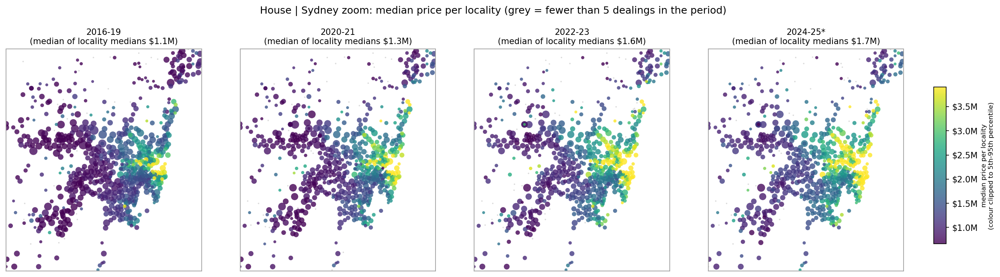
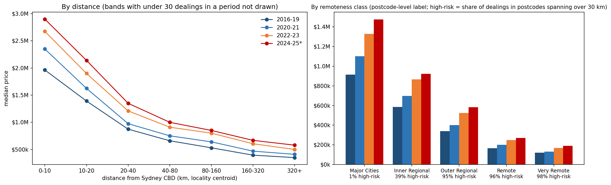

# NSW Property Sales 2016–2025
### Rebuilding a price model from the raw archive, and what the rebuild changed

**Mehmood Ahmed Khan** | Data Scientist & Analytics Engineer

[](https://www.python.org/)
[](https://pandas.pydata.org/)
[](https://scikit-learn.org/)

The first version of this project looked finished: a SQL pipeline, 23 charts, a case study and a headline model score. When I went back to the raw government archive to check it, several of its foundations did not hold. This repository documents the rebuild: what was wrong, how it was found, what replaced it, and what the corrected model can and cannot do.

> **Status.** The analysis and models described here are complete. A map app and a presentation are planned and will be added to this repository. The earlier SQL version is kept for the record in [`archive/notebooks/`](archive/notebooks/), [`archive/Visual/`](archive/Visual/) and [`archive/presentation/`](archive/presentation/) and is **superseded**.

---

## At a glance

| | |
|---|---|
| **Source** | NSW Valuer General weekly property-sales extracts: 10 yearly archives, 520 weekly extracts, 66,747 district files, 4 Jan 2016 to 29 Dec 2025 |
| **Raw sale lines** | 2,186,102, of which 153,584 (7.0%) were the same sale re-published in a later extract and were removed |
| **Cleaned rows** | 2,032,518, with **0 imputed values**; 24 automated checks pass |
| **Unit of a sale** | the *dealing*: 1,978,968 dealings (35,377 span two or more lots) |
| **Modelling scope** | 1,899,113 dealings settled January 2016 to late October 2025 (96.0% of all dealings) |
| **Segments modelled** | House, Unit, Vacant land, Acreage residence |
| **Validation design** | train 2016–2023, tune on 2024, report once on 2025 |

### Headline results (2025 test year)

| Segment | Dealings tested | Typical error | Within 10% of the price | R² (log price) | Linear baseline error |
|---|---|---|---|---|---|
| House | 82,992 | **13.4%** | 39.7% | 0.762 | 16.7% |
| Unit | 51,255 | **10.0%** | 49.9% | 0.717 | 18.6% |
| Vacant land | 10,740 | **13.9%** | 39.5% | 0.678 | 25.4% |
| Acreage residence | 3,986 | **24.0%** | 21.3% | 0.546 | 31.2% |

*Typical error is the median absolute percentage error: half of the predictions are within that percentage of the actual price. R² is on log price and should not be compared across segments, because price spread differs by segment. Details, baselines and ablations: [`docs/model_evaluation.md`](docs/model_evaluation.md).*

---

## The story: six things the first version got wrong

The first version merged the yearly files into one CSV, loaded it into DuckDB and modelled it. Re-extracting from the raw archive, with row counts checked at every step, showed the following.

| # | First version | What the rebuild found | What changed |
|---|---|---|---|
| 1 | Used a merged CSV of 1,697,724 rows | The same sale is often **re-published** in later weekly extracts, and the merged file had lost lines and dates | Extracted from the raw archive; every row accounted for (2,186,102 lines in, 153,584 duplicates out, 2,032,518 kept) |
| 2 | Assumed every area was in square metres | **139,687 rows (6.9%) are recorded in hectares**; the unit is a field in each record | Area unit read from each row; no single-unit assumption |
| 3 | Treated 2023 as a "gap caused by a filing artefact" and excluded it | The dates had been **lost in the earlier extraction**; the raw files contain them | 2023 restored (177,979 dealings); no source year is missing |
| 4 | Treated each row as one sale | One sale can span several lots, with the **same total price repeated on every lot** | Analysis at the dealing level; price per m² uses total price over total area (the old per-row figure was too high by a median factor of 2.4 on multi-lot rows) |
| 5 | Used postcode-level LGA and remoteness labels as if they described the locality | Those labels are **identical for every locality in a postcode** in 629 of 634 postcodes; 35% of postcodes span more than 20 km | Maps use locality coordinates; postcode-level labels carry a risk flag and were tested as model inputs (they added nothing) |
| 6 | Reported one model score from a random split on pooled residential data | A random split lets the same property appear on both sides, and one earlier pandas result (R² 0.84) was inflated by duplicated rows | Time-based validation, one row per dealing, separate models per segment, and baselines to beat |

Headline findings from the first version that depended on items 2 and 5 (for example the Metro versus Very Remote price-per-m² ratio and the LGA rankings) are **retired**, not carried forward.

Two further decisions came from the data:
- **The analysis window moved from 2018–2025 to 2016–2025.** The earlier start was a policy choice, not a data limit. January 2016 sales are as complete as later months (the first six months run at 84% to 102% of the same months a year later), so the extra two years were kept.
- **"House" and "Unit" are proxies.** The raw data has **no dwelling-type field**: nothing says house, townhouse, villa or apartment. A *Unit* here means strata-titled (apartments, but also strata townhouses and villas), and a *House* means a freehold residence on under 2 hectares.

---

## What the pipeline does now

```
NSW Valuer General weekly archives (10 zips, 520 extracts)
        │
        ▼
 1  EXTRACTION AND CLEANING
    parse every sale line; remove re-published copies (keep the latest, record the
    first publication date); read the area unit per row; match places by
    (locality, postcode); no imputation; every rule logs the rows it touches
        │            2,032,518 rows, 24 automated checks
        ▼
 2  SCOPE AND SEGMENTS
    one row per dealing; window, incomplete-tail and price rules as flags with a
    row ledger; segment label per dealing (House, Unit, Acreage residence, Vacant
    land, Farm or rural, Commercial or other)
        │            1,899,113 in-scope dealings
        ▼
 3  GROUP EDA AND MAPS
    the same six images per segment, four time periods each, one dot per locality
        │
        ▼
 4  MODELS
    as-of price features, time-based validation, baselines, ablations, a
    counter-check with other boosting libraries
```

Design rules that held throughout: **no imputation; flag, do not filter; no step may multiply rows; every exclusion appears in a ledger with its row count.**

### Scope: what is in and out

| Rule (applied in order) | Dealings removed |
|---|---|
| Settled before 2016 | 19,500 |
| Settled in the incomplete last 60 days | 40,456 |
| Revision pair (same sale, conflicting price) | 193 |
| Lots disagree on one price | 18 |
| Freehold lot with a unit number in the address | 8,204 |
| Bulk sale (5 or more lots) | 1,542 |
| Price under $10,000 | 8,721 |
| Price over $50,000,000 | 1,221 |
| **Remaining** | **1,899,113** |

Nothing is deleted from the cleaned data; these are scope flags. After the window rule, no rule moves the house or unit median, so the exclusions protect the models from odd rows without changing the picture. The reasoning behind each threshold is in [`docs/pipeline_architecture.md`](docs/pipeline_architecture.md).

### Segments

| Segment | Dealings in scope | Median price, first period → last period |
|---|---|---|
| House | 943,278 | $650k → $1.03M |
| Unit | 600,499 | $670k → $780k |
| Vacant land | 202,293 | $321k → $480k |
| Acreage residence | 51,160 | $675k → $1.17M |
| Farm or rural | 26,700 | $750k → $1.45M |
| Commercial or other | 68,767 | $660k → $920k |
| Unknown | 6,416 | not shown |

*Periods are 2016–19 and 2024–25 (the latter to late October). The two descriptive segments, Farm or rural and Commercial or other, are not modelled because each mixes very different kinds of property.*

---

## How the models are built, and how they are kept honest

- **Target:** log price at the dealing level, scored back in dollars.
- **Main inputs:** the price level of the locality and of the whole segment **as it stood in earlier months**, location and distance from the Sydney CBD, area, zoning, lot counts, and, where they exist, the **previous sale of the same dwelling** and the **price level of the same building** (strata).
- **Leakage controls:** those price levels use only sales settled in strictly earlier months, never the dealing's own month. This was tested against a brute-force calculation and with a probe that edits one price and checks that nothing in that month or earlier changes; the functions and their tests are in [`code/`](code/). Category lists are learned from the training years only, and `Price_per_sqm` is never an input.
- **Protocol:** fit on 2016–2023 and tune on 2024; refit on 2016–2024 and score 2025 once. The test year chooses nothing.
- **Baselines the model has to beat:** a frozen median, the segment's price level, the locality's price level, and a linear (Ridge) model.

### What the results say

- **The model beats every baseline in every segment**, but modestly against the linear model for houses (13.4% against 16.7% typical error). Much of the signal is the neighbourhood's recent price level, area and location.
- **Price history is the biggest single gain.** Without it the typical error is 15.2% (House), 15.9% (Unit), 14.5% (Vacant land) and 26.5% (Acreage). Only about a third of 2025 house sales have an earlier sale in the data, so the gain comes from a minority of dealings. For units the building-level history matters most.
- **Postcode-level labels added nothing** (House 15.1% against 15.2%, Unit 15.8% against 15.9%, Acreage 26.6% against 26.5%; Vacant land was worse, 14.8% against 14.5%), so the final models leave them out.
- **A counter-check with LightGBM and XGBoost** reproduced the main model's scores exactly and found no candidate that beat it by the margin set in advance (0.5 percentage points, with a confidence interval excluding zero). The best case, a three-model blend for units, gained 0.3 points. That check is **shelved**: the accuracy is not an artefact of one library.
- **The earlier benchmark is not quoted.** The first version's best score (R² 0.714) used a different row set, split and labels, so it is not comparable with these results.

---

## What the market looks like (descriptive, not causal)

<p align="center">
  
</p>

- **Prices rose unevenly.** From 2016–19 to 2024–25 the median rose 58% for houses, 16% for units, 50% for vacant land and 73% for acreage residence. Acreage and farm medians have been roughly flat since 2022–23.
- **Distance from Sydney matters, but not evenly.** House prices fall steeply with distance from the CBD and flatten beyond about 80 km (see the chart below). For units the pattern is not monotone: the median rises again beyond 320 km, which may be the far north coast, but that was not tested.
- **Prices cluster on round numbers.** Exactly $1,000,000 occurs 4.2 times as often as nearby prices, and exactly $2,000,000 occurs 13 times as often. Sales are priced on round numbers, which shows up as sharp edges in price histograms.
- **Sub-$10,000 sales are fading.** They were 0.80% of dealings in 2016 and 0.14% in 2025. Most are rural vacant land, and the cause is unknown.
- **Publication got faster.** The median delay between settlement and first publication fell from 19 days (2016) to 7 days (2019 onward).

<p align="center">
  
</p>

---

## Limits, stated plainly

- **No property attributes.** There is nothing on bedrooms, condition, building age or views. Accuracy has a ceiling set by that, and the typical error is a statement about valuing from location, area and price history only.
- **Proxies, not types.** House and Unit are inferred from strata title and area (see above).
- **Price history helps only where it exists.** The previous-sale and building features need earlier sales, and the data starts in 2016.
- **The price levels are slightly optimistic.** They assume last month's sales are known when valuing, but a few sales take weeks to be published.
- **Scope.** Prices under $10,000 and over $50 million, bulk sales and revision pairs are outside the model, so the accuracy applies to ordinary in-scope sales.
- **Postcode-level labels remain unreliable.** About 28% of sales sit in postcodes flagged high-risk. They are not used by the final models, and any map is drawn from locality coordinates.
- **The test year has been looked at more than once.** Design choices for the history features were made after seeing the first run's results, so the final test figures are slightly flattering.
- **Not tried:** random forest, prediction intervals, a repeat-sales index and macro-economic inputs such as the cash rate.

---

## What is in this repository

```
README.md                  this file
docs/
  data_provenance.md       where the data comes from, what it can and cannot tell you
  pipeline_architecture.md the design, the rules and the evidence behind each decision
  model_evaluation.md      full results, ablations, the counter-check and the leakage audit
  images/                  figures used in the documents
code/
  price_history_features.py       the two leakage-critical feature functions
  test_price_history_features.py  15 tests on synthetic data (run: cd code && pytest -q)
archive/notebooks/         the superseded first-version SQL notebook (kept for the record)
archive/Visual/            charts from the superseded first version
archive/presentation/      the first version's case-study page (superseded); a new presentation is planned
````

**The full analysis code is not published.** Every figure...
````notebook, and the documents describe the method, the rules and the checks in enough detail to reproduce them from the public source data. The one piece that is published is the part most open to doubt: the functions that build price-history inputs without leakage, with tests that need no data ([`code/`](code/)). They show that those functions behave as described; they do not on their own show that the whole pipeline is leak-free (see the audit in [`docs/model_evaluation.md`](docs/model_evaluation.md)). [Add a line here if you choose to offer the rest of the code on request.]

---

## Data sources

| Source | Use |
|---|---|
| [NSW Valuer General](https://valuation.property.nsw.gov.au/embed/propertySalesInformation), weekly property sales extracts, published under Creative Commons | all sales data; attribute NSW Valuer General when reusing |
| [Matthew Proctor, Australian Postcodes](https://matthewproctor.com/australian_postcodes) | locality coordinates and postcode reference |

---

## Earlier work

The first version of this project, a DuckDB SQL pipeline over a merged CSV with 23 charts and a case-study page, is kept in [`archive/notebooks/`](archive/notebooks/), [`archive/Visual/`](archive/Visual/) and [`archive/presentation/`](archive/presentation/). It is **superseded**, and its headline findings are retired for the reasons in the table above.

---

## Author
**Mehmood Ahmed Khan**, Data Scientist & Analytics Engineer

[](https://www.linkedin.com/in/mehmoood)
[](https://github.com/Mehmoodkhans)
